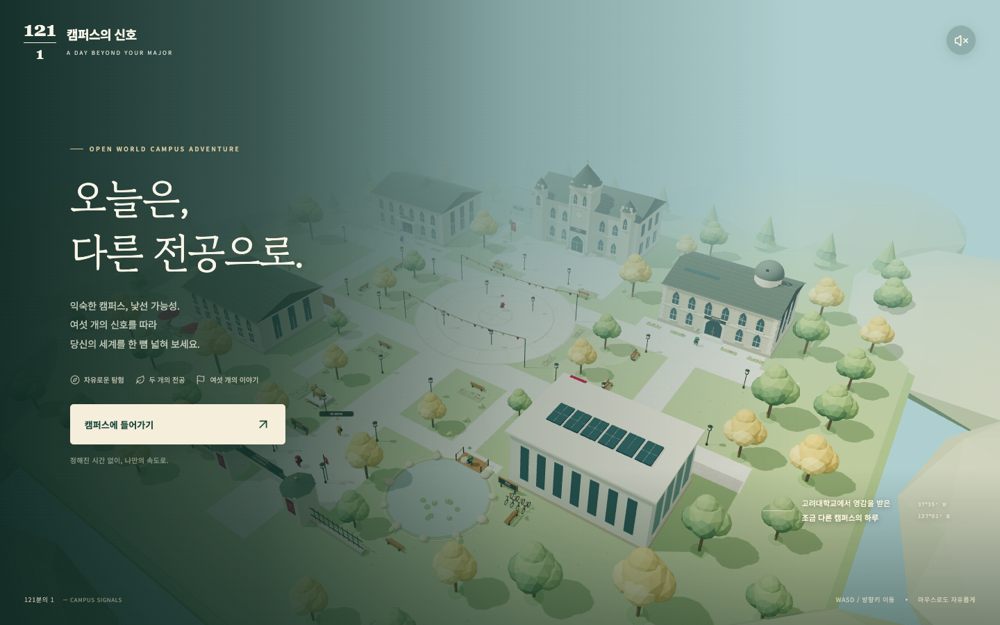
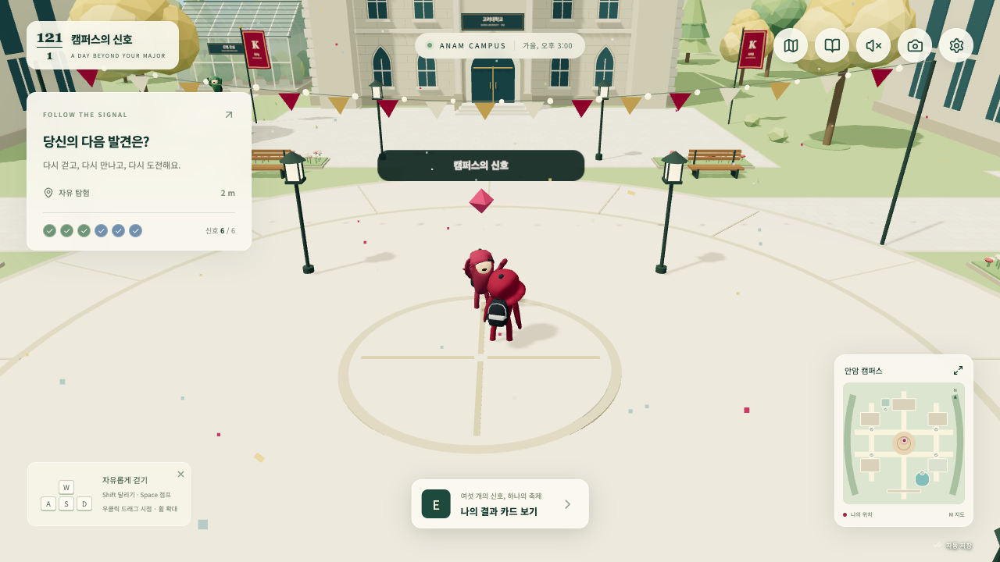

# 121분의 1 · 캠퍼스의 신호

고려대학교의 석조 고딕 건축과 가을 캠퍼스에서 영감을 받은 **Next.js 16 + Three.js 3D 오픈월드 게임**입니다. 원본 [coastalworld-local](https://github.com/leeminsuk/coastalworld-local)의 실제 캐릭터 모델과 애니메이션을 재사용하고, 캠퍼스·게임 화면·퀘스트·저장 시스템을 새로 만들었습니다.

시간제한 없이 캠퍼스를 걸으며 생명과학과 정보보안의 여섯 신호를 되찾고, 전공 교류제의 불빛을 켜 보세요. 추천 순서를 따르지 않아도 모든 장소와 퀘스트를 처음부터 방문할 수 있습니다.



## 실행

Node.js 20.9 이상과 WebGL2 지원 브라우저가 필요합니다. 로그인, API 키, 외부 데이터베이스는 필요하지 않습니다.

```bash
npm ci
npm run dev
```

[http://127.0.0.1:3000](http://127.0.0.1:3000)에서 플레이하세요.

```bash
# 배포용 빌드와 실행
npm run build
npm start

# 타입 및 게임 상태 검사
npm run check
```

Vercel 등 Next.js 지원 호스팅에는 기본 Next.js 설정으로 배포할 수 있습니다. 이 저장소는 비공개 보관을 목적으로 하며, 자동으로 공개 배포하지 않습니다.

## Next.js를 어떻게 사용했는가

이 프로젝트의 실행 서버와 앱 구조는 **Next.js 16의 App Router**입니다. `npm run dev`는 `next dev`, `npm run build`는 `next build`, `npm start`는 `next start`를 실행합니다. 게임 화면 전체를 Next.js 앱의 React 컴포넌트로 구현했으며, 별도 HTML 게임을 iframe으로 끼워 넣는 구조가 아닙니다.

| Next.js / React 구성 | 실제 파일 | 담당하는 기능 |
| --- | --- | --- |
| App Router의 `/` 경로 | [`src/app/page.tsx`](src/app/page.tsx) | 루트 페이지에서 게임 컴포넌트 렌더링 |
| 루트 레이아웃과 메타데이터 | [`src/app/layout.tsx`](src/app/layout.tsx) | 한국어 문서, 제목·설명·뷰포트, 공통 CSS와 로컬 폰트 |
| 클라이언트 컴포넌트 | [`src/components/Game.tsx`](src/components/Game.tsx) | `"use client"` 경계 안에서 도입·퀘스트·지도·대화·설정·사진·결과 화면과 상태 관리 |
| 미니게임 React UI | [`src/components/QuestChallenge.tsx`](src/components/QuestChallenge.tsx) | 여섯 퍼즐의 입력·판정·힌트·해설·점수 반영 |
| 브라우저 전용 3D 로딩 | `Game.tsx`의 `useEffect` → `import('@/game/engine')` | 서버 렌더링 중에는 WebGL·`window`·`document`에 접근하지 않고, 마운트된 뒤에 Three.js 엔진 생성 |
| 정적 파일 제공 | [`public/`](public/) | 모델·텍스처·Draco 디코더·폰트를 `/assets/`, `/vendors/`, `/fonts/`로 제공 |
| 오류 화면 | [`src/app/error.tsx`](src/app/error.tsx) | React 화면 오류 발생 시 재시도 UI |
| 프로덕션 빌드 | [`next.config.ts`](next.config.ts), [`package.json`](package.json) | TypeScript 검사, 코드 번들링·분할, 정적 페이지 사전 생성, Next.js 서버 실행 |

동작 흐름은 다음과 같습니다.

```text
브라우저 → Next.js의 / 페이지 → React Game UI
                                  │
                                  ├─ 지도·대화·퍼즐·결과 화면
                                  ├─ 브라우저 자동 저장 / JSON 백업
                                  └─ 동적 로딩된 Three.js 엔진
                                       ├─ 캠퍼스 렌더링·카메라·충돌
                                       └─ 원본 GLB 캐릭터·애니메이션
```

초기 HTML은 Next.js가 사전 생성하고, 브라우저에서 React가 상호작용을 연결합니다. 움직임과 렌더링은 Three.js가 담당하며, 엔진의 가까운 NPC·현재 위치 이벤트를 React UI와 연결했습니다. 페이지가 해제될 때는 렌더 루프·이벤트·GPU 자원을 정리합니다.

이번 게임은 브라우저에서 완주 가능한 단일 사용자 게임이므로 **API Route, 별도 백엔드, Supabase, LLM API를 필수로 두지 않았습니다.** 저장은 `localStorage`와 JSON 파일을 사용합니다. 원본 비교용 `/original/index.html`은 별도로 보존한 참고 자료이며, 새 게임의 실행 경로는 `/`입니다. 구현 방식은 [Next.js 공식 App Router 설치·구조 안내](https://nextjs.org/docs/app/getting-started/installation)를 참고했습니다.

## 조작

| 조작 | 동작 |
| --- | --- |
| WASD / 방향키 | 이동과 캐릭터 애니메이션 |
| Shift | 더 빠르게 달리기 |
| Alt | 천천히 걷기 |
| 지면 클릭 / 누른 채 이동 | 해당 방향으로 이동 |
| 우클릭 드래그 | 카메라 회전 |
| 마우스 휠 | 확대·축소 |
| Space | 점프 |
| E / Enter | 가까운 NPC·발견물과 상호작용 |
| M | 지도와 목적지 선택 |
| J | 퀘스트·발견 노트 |
| P | 사진 모드 |
| Esc | 화면 닫기·일시정지 메뉴 |
| 모바일 방향 버튼 | 터치 이동 |

지도에서 목적지를 선택하면 빛나는 점이 방향을 알려 줍니다. 다른 길을 선택하거나 퀘스트를 미뤄도 괜찮습니다. 건물은 외관 중심으로 구성되어 있으며, 체험은 바깥의 연구원·학생 NPC에게 말을 걸어 시작합니다.

## 처음부터 끝까지

1. 닉네임과 관심 전공을 적어 캠퍼스 여권을 만듭니다. 비워 두어도 시작할 수 있습니다.
2. 안내자 호연에게 공동 축제 장치의 이야기를 듣습니다.
3. 다음 여섯 의뢰를 **원하는 순서대로** 해결합니다.
4. 중앙광장으로 돌아와 여섯 신호로 축제를 밝힙니다.
5. 나의 결과 카드를 PNG로 저장하고, 계속 탐험하거나 퀘스트 최고점에 다시 도전합니다.

| 장소 | 퀘스트 | 실제 조작 |
| --- | --- | --- |
| 생태 연못 | 연못의 작은 균형 | 수온·pH·용존 산소 슬라이더 조절 |
| 은행 온실 | 씨앗에 적힌 편지 | 여섯 DNA 염기를 짝 규칙에 맞춰 복원 |
| 생명과학관 | 함께 살아가는 정원 | 정원 생태계의 세 역할을 골라 구성 |
| 학생회관 | 수상한 축제 초대장 | 다섯 메시지 판별, 매 문항 해설 |
| 미래정보관 | 끊어진 신호를 잇다 | 안전한 네트워크 경로 순서 선택 |
| 중앙도서관 | 도서관의 마지막 암호 | 이동 암호 해석과 정답 입력 |

오답을 내도 게임이 막히지 않습니다. 피싱은 모든 문항을 끝내면 실제 정답 수를 반영해 완료하고, 나머지 퍼즐은 힌트와 재시도를 제공합니다. 재도전 시 최고점을 보존합니다.

선택 탐험으로 네 개의 작은 순간을 여권에 남길 수 있고, 오래된 책의 단서를 따라 숨겨진 발자국 퍼즐을 발견할 수 있습니다. 발견 수집과 이스터에그는 본편 엔딩의 필수 조건이 아닙니다. 사진 모드에서는 게임 화면을 숨기고 카메라를 조절해 실제 3D 장면을 저장할 수 있습니다.



## 저장

진행 기록, 위치, 닉네임, 최고점, 발견 도장은 현재 브라우저의 `localStorage`에 자동 저장됩니다. 설정에서 JSON 백업을 내려받거나 다시 불러올 수 있습니다. 브라우저·포트·주소를 변경하기 전에는 백업하세요. 로컬 저장을 차단한 환경에서도 게임은 작동하지만 기록을 파일로 보관해야 합니다.

실시간 서버 랭킹·계정·AI API는 사용하지 않습니다. 결과 문구는 플레이 점수에 따른 규칙 기반 문구이며, 생태 수치는 게임 속 실험 조건입니다.

## 구성

- `src/app/`: Next.js App Router, 화면 스타일과 메타데이터
- `src/components/Game.tsx`: 도입·HUD·지도·대화·발견·사진·결과 화면
- `src/components/QuestChallenge.tsx`: 여섯 미니게임과 피드백
- `src/game/engine.ts`: 입력·카메라·이동·충돌·NPC·애니메이션 연결
- `src/game/world.ts`: 석조 건물·온실·연못·산책길·축제 연출
- `src/game/character.ts`: 원본 GLB·표정·걷기·달리기·춤 애니메이션
- `src/game/content.ts`, `discoveries.ts`: 시나리오·퀘스트·맵·발견 데이터
- `src/game/state.ts`: 순서 독립 진행·저장 검증·결과 계산
- `public/assets/`, `public/vendors/`: 원본 모델·텍스처·Draco 디코더
- `public/fonts/`: 자체 호스팅 폰트와 OFL 고지
- `public/original/index.html`: 비교용 원본 실행 진입점

원본의 정적 서버와 테스트·복구 도구는 `reference/`에 보존했습니다. 현재 실행에는 Next.js만 사용합니다.

## 문서와 검증

- [시나리오 및 설계](docs/scenario.md)
- [캠퍼스 공간과 조사 자료](docs/campus-design.md)
- [원본에서 재사용한 부분](docs/source-adaptation.md)
- [실제 브라우저 완주 검증](docs/verification.md)
- [원본 README](docs/ORIGINAL-README.md)

## 출처

원본 캐릭터·표정·애니메이션·보존 자산은 **Coastal Community Bank / Merci-Michel**의 [Coastal World](https://coastalworld.merci-michel.com/) 및 [leeminsuk/coastalworld-local](https://github.com/leeminsuk/coastalworld-local)에서 가져왔습니다. 기존 고지와 저작권은 유지하며, 원작 전체에 새로운 오픈소스 라이선스를 부여하지 않습니다.

맵은 고려대학교에서 영감을 받아 코드로 만든 가상의 캠퍼스입니다. 실제 지형의 정확한 복제나 학교 공식 게임이 아닙니다. Gowun Batang과 Noto Sans KR은 `public/fonts/`에 포함된 SIL Open Font License를 따릅니다.
