# Coastal World — Localhost

[Coastal World 원본](https://coastalworld.merci-michel.com/)의 3D 장면, 캐릭터, 애니메이션, 지도와 미니게임을 로컬에서 실행하는 보관용 프로젝트입니다. 원본 웹빌드의 렌더러와 게임 자산을 사용합니다.

누락된 JavaScript 번들과 모델·텍스처·음원·게임 데이터를 복구하고, 외부 자산 프록시 없이 실행하도록 수정했습니다. 원본의 이메일 계정 및 클라우드 저장은 **브라우저 자동 저장과 JSON 백업·복원**으로 바꾸었습니다.

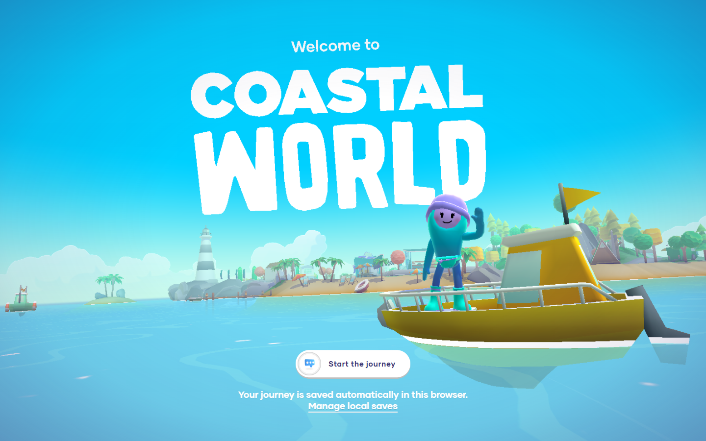

## 실행

Node.js 20 이상과 WebGL을 지원하는 브라우저가 필요합니다. Windows에서는 Chrome으로 확인했습니다.

```powershell
gh repo clone leeminsuk/coastalworld-local
cd coastalworld-local
node server.mjs
```

**http://localhost:4173** 에 접속하세요. `npm install`, 빌드, 배포 계정이나 API 키는 필요하지 않습니다. 서버는 이 PC의 `127.0.0.1`에서만 연결을 받습니다. 종료하려면 서버 터미널에서 `Ctrl+C`를 누릅니다.

포트를 변경하려면 PowerShell에서 다음과 같이 실행합니다.

```powershell
$env:PORT = "4174"
node server.mjs
```

브라우저 저장은 주소별로 구분됩니다. `localhost`, `127.0.0.1` 또는 포트를 바꾸기 전에 **Local saves → Download backup**으로 진행 상황을 보관하세요.

## 조작과 저장

| 기능 | 조작 |
| --- | --- |
| 섬에서 이동 | 방향키 또는 WASD |
| NPC와 대화·다음 대사 | 가까이에서 Enter 또는 대화 아이콘 |
| 지도와 퀘스트 | 오른쪽 아래 휴대전화 |
| 다른 섬으로 이동 | 지도 핀 선택 → 이동 확인 |
| 캐릭터 꾸미기 | 오른쪽 위 얼굴 버튼 |
| 미니게임 | 자동 전진, ←/→ 또는 A/D로 조향 |
| 음소거 | 오른쪽 위 스피커 버튼 |
| 저장·백업·복원 | 메뉴 → Local saves |

진행 상황은 현재 브라우저에 자동 저장됩니다. **Download backup**으로 받은 JSON 파일은 **Restore backup**에서 다시 불러올 수 있습니다. 잘못되거나 손상된 파일은 기존 진행 상황을 보존하며 거부합니다.

## 직접 실행한 화면

아래 이미지는 이 프로젝트를 `http://localhost:4173`에서 실행하고 브라우저로 직접 캡처한 화면입니다. 원본 사이트의 홍보 이미지나 생성 이미지가 아닙니다.

### 섬과 지도

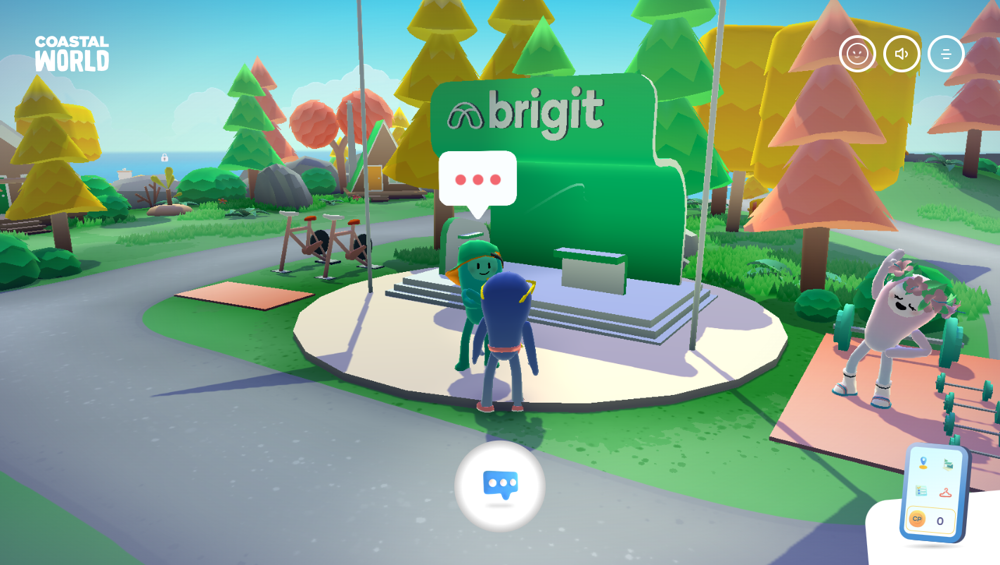

| Wild Island | Lake Island |
| --- | --- |
| 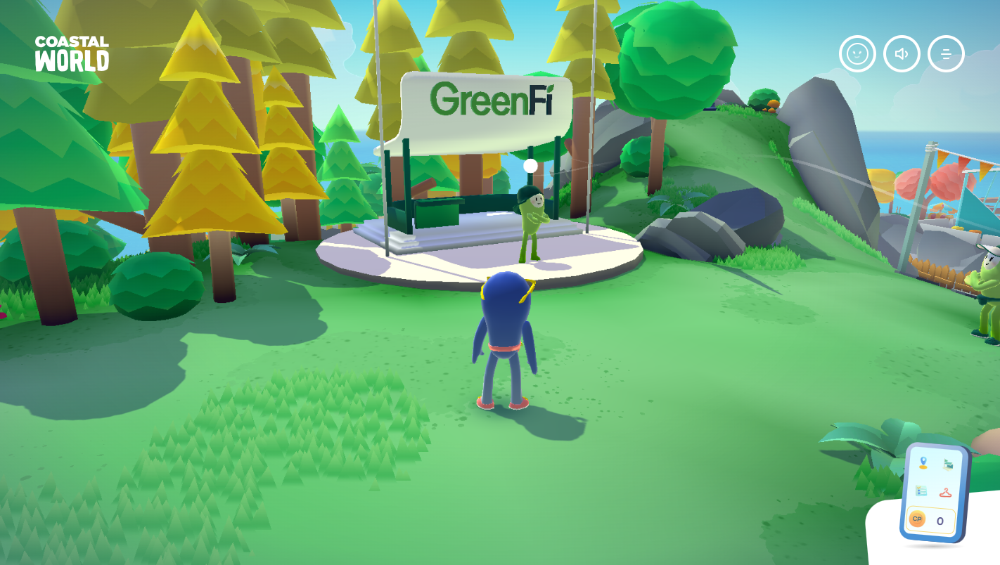 | 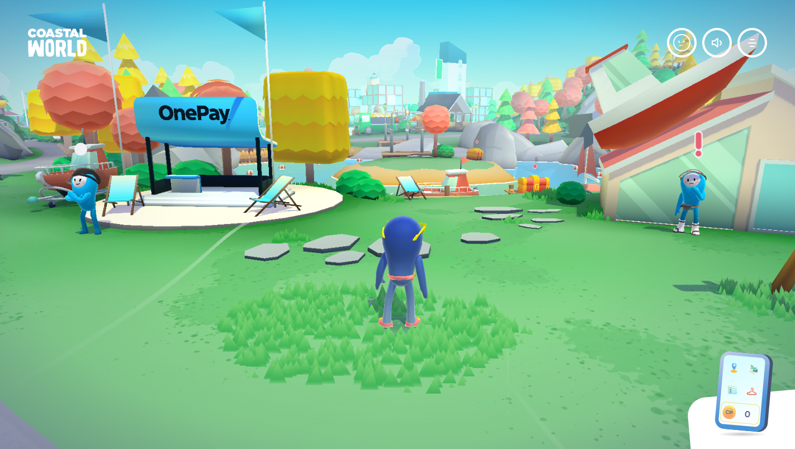 |

| Palm Island | 지도 |
| --- | --- |
| 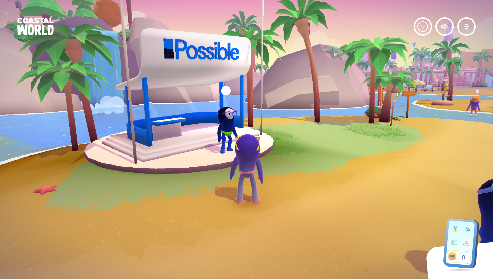 | 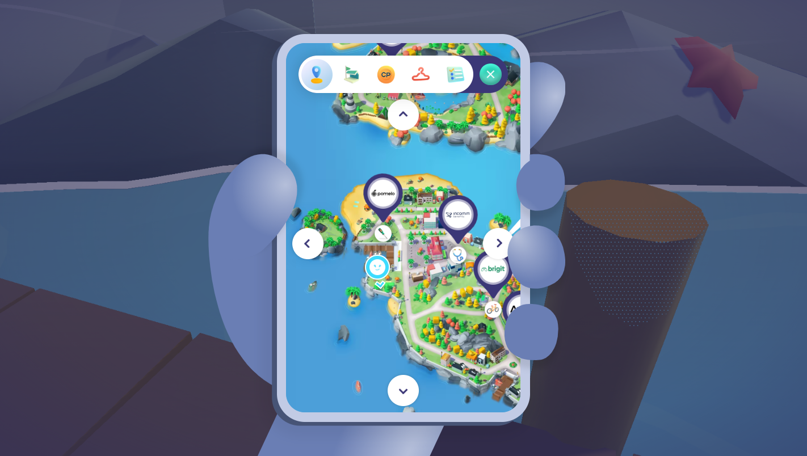 |

### 방향키 이동 전후

실제 브라우저 키보드 이벤트를 입력하고 게임의 캐릭터 좌표 변화를 읽어 확인했습니다. 좌표를 직접 바꿔 이동 결과를 만들지 않았습니다.

| 이동 전 | 이동 후 |
| --- | --- |
| 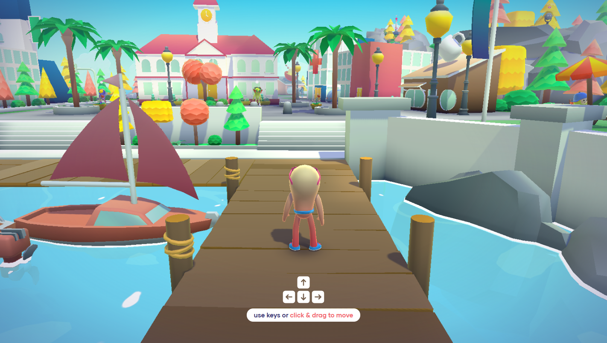 | 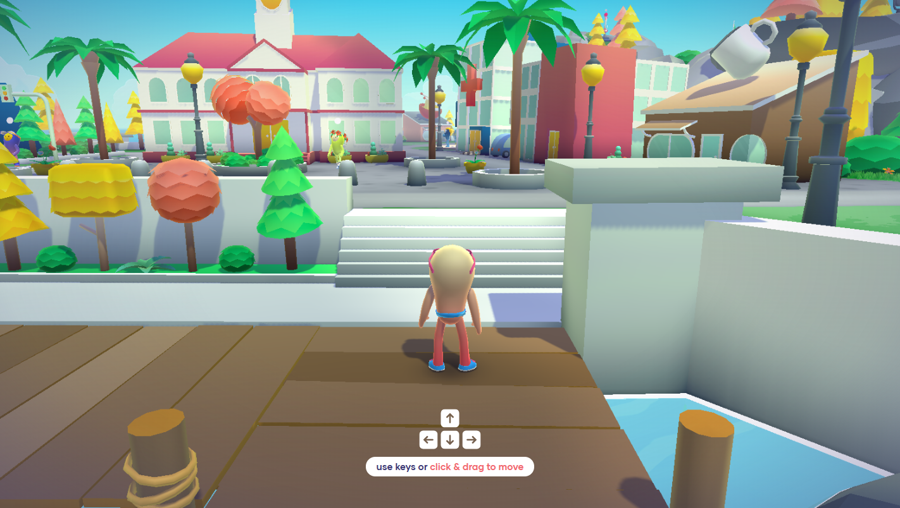 |

| 키 | 약 1.4초 입력 후 수평 이동 거리 |
| --- | ---: |
| ↑ | 10.12 게임 좌표 단위 |
| ↓ | 10.01 게임 좌표 단위 |
| ← | 6.88 게임 좌표 단위 |
| → | 7.33 게임 좌표 단위 |

### 꾸미기와 로컬 저장

| 캐릭터 꾸미기 | 백업·복원 |
| --- | --- |
| 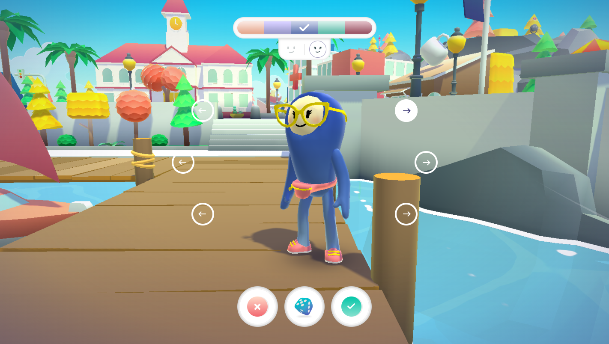 | 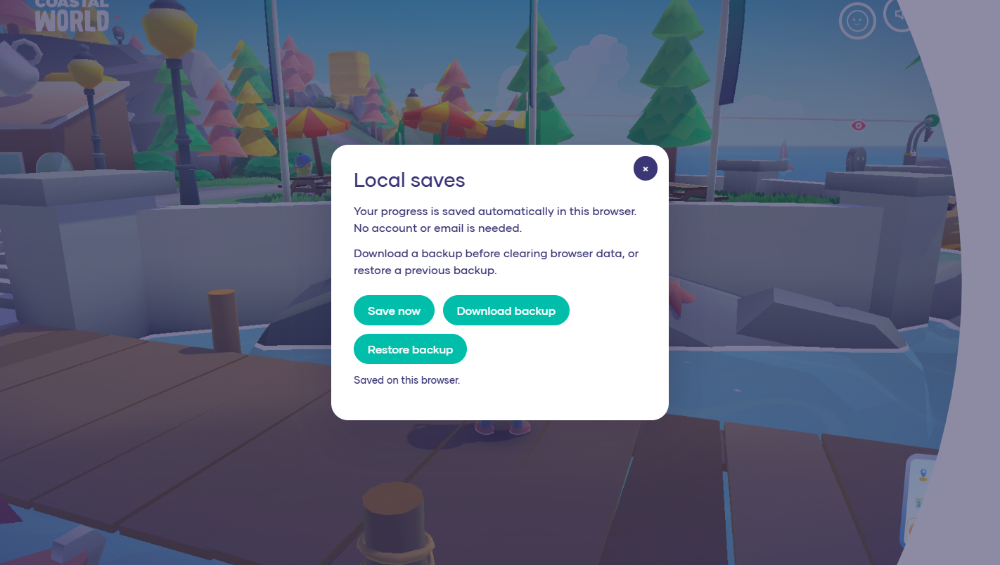 |

### 미니게임

| 자전거 | 자동차 |
| --- | --- |
| 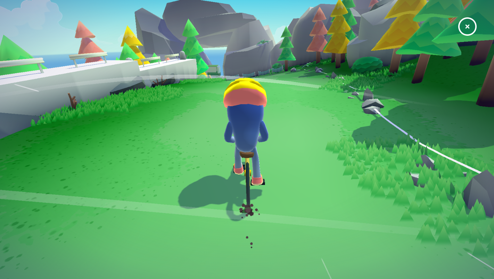 | 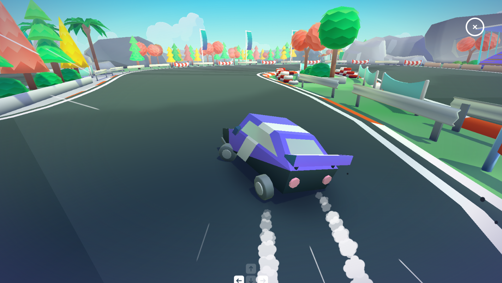 |

| 보트 | 제트스키 |
| --- | --- |
| 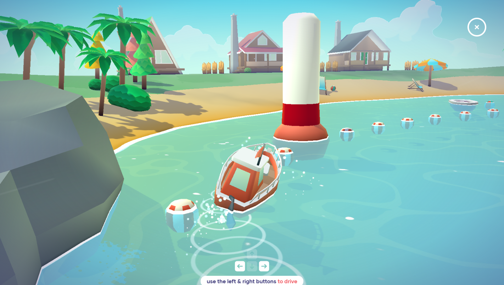 | 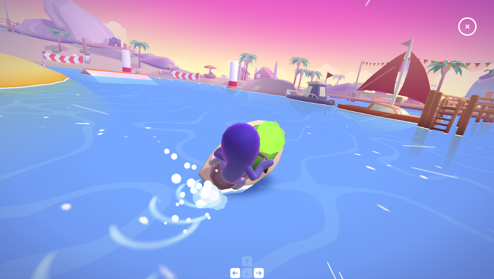 |

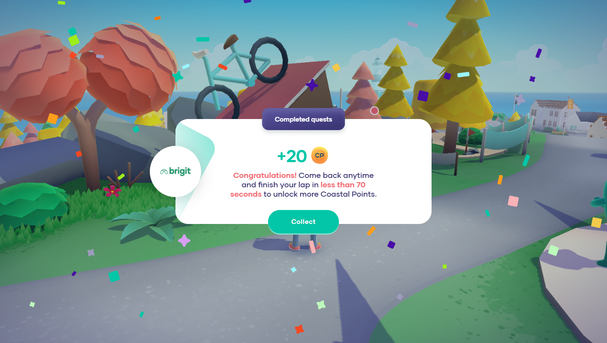

## 검증

2026-10-13, Windows / Chrome 154.0.8037.98 / Node.js 24.19.0에서 확인했습니다.

- 첫 로딩, 인트로와 NPC 대화, 네 방향 실제 키 입력에 따른 캐릭터 이동.
- 지도를 마우스로 이동하고 핀을 선택해 Cove / Wild / Lake / Palm 섬 사이 이동.
- 캐릭터 색상·얼굴·액세서리 변경과 새로고침 후 유지.
- 브라우저 저장, 백업 다운로드, 다른 의상으로 변경한 뒤 백업을 가져와 이전 상태 복원.
- 잘못된 백업 파일을 거부하고 현재 저장 내용 유지.
- 유효한 형식에 손상된 게임 데이터를 넣은 백업도 거부하고 기존 저장 보존.
- 네 미니게임의 실제 방향키 조향, 완주 판정, 퀘스트 보상, 원래 섬 복귀.
- 완료한 퀘스트 4개와 포인트 유지, 게임 포인트로 샌들 구매 후 새로고침해도 소유권 유지.
- 퀘스트·액세서리·브랜드 화면, 음소거 전환과 오디오 컨텍스트 실행 상태.
- **비공개 GitHub 저장소에서 새로 clone한 사본**에서 인트로 → 섬 진입 → 방향키 이동. 이 검사에서는 외부 HTTP 요청을 차단했으며, 외부 요청·실패한 응답·JavaScript 예외가 모두 0건이었습니다.

| 미니게임 | 검증 주행 시간 | 완주·보상·섬 복귀 |
| --- | ---: | --- |
| 자전거 | 67.99초 | 통과 |
| 자동차 | 74.84초 | 통과 |
| 보트 | 58.33초 | 통과 |
| 제트스키 | 81.73초 | 통과 |

자전거는 NPC 대화로 진입했습니다. 나머지 레이스는 NPC가 사용하는 장면 전환 함수를 호출해 진입한 다음, 모두 브라우저의 실제 키보드 이벤트로 조향했습니다. 주행 중 좌표나 완주·보상 상태를 강제로 변경하지 않았습니다. 위 시간은 최고 기록이 아닌 검증 주행의 게임 내 시간입니다. 레이스 검사 중 JavaScript 예외와 실패한 자산 응답은 0건이었습니다.

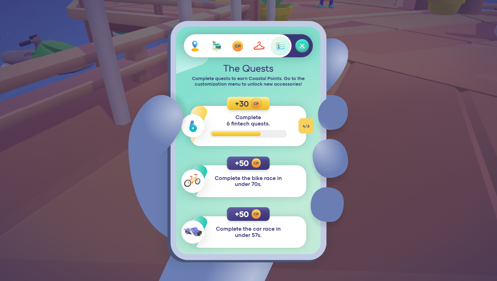

검증 범위는 위 항목입니다. 모든 NPC 대사 분기, 모든 퀘스트 조합과 다른 브라우저까지 전수 검사한 것은 아닙니다.

서버와 자산 검사는 다음 명령으로 다시 실행할 수 있습니다.

```powershell
npm.cmd run check
npm.cmd test
```

검사는 SPA 경로, JavaScript·WASM·GLB 응답 형식, 오디오 부분 요청, 누락 파일 처리, 비공개 폴더 접근 차단, 1,000개 이상의 번들 자산 참조를 확인합니다. 브라우저에서 직접 한 게임 조작 검증은 이 서버 검사와 별도로 진행했습니다.

## 원본과의 차이 및 구성

- 게임의 장면과 렌더러, 물리 처리, NPC, 퀘스트, 네 가지 미니게임은 원본 웹빌드를 사용합니다.
- 서버 로그인과 클라우드 동기화 대신 로컬 자동 저장 및 백업 UI를 제공합니다. 분석·쿠키 동의·로그인용 reCAPTCHA 호출은 비활성화했습니다.
- 모델·텍스처·음원·게임 데이터는 저장소에 포함되어 원본 자산 서버가 없어도 로드됩니다. NPC 소개의 **YouTube 영상과 외부 브랜드 링크는 인터넷 연결이 필요**하며, 영상은 Skip으로 넘길 수 있습니다.
- 원본 개발 프로젝트의 미니파이 전 소스나 편집용 3D 원본 파일은 포함하지 않습니다. `assets/`는 실행용 웹빌드입니다.

| 경로 | 역할 |
| --- | --- |
| `server.mjs` | 의존성 없는 localhost 정적 서버 |
| `local-runtime.js` | 로컬 저장·백업 UI와 외부 서비스 분리 |
| `assets/`, `vendors/`, `icons/` | 게임 번들, 데이터, 모델, 이미지, 음원, Draco 디코더 |
| `tests/server.test.mjs` | 서버 응답과 자산 참조 검사 |
| `scripts/sync-assets.py` | 원본 공개 자산에서 누락 파일을 복구한 도구 |
| `docs/screenshots/` | 직접 촬영한 로컬 실행 화면 |

## 출처

원작은 **Coastal Community Bank / Merci-Michel**의 [Coastal World](https://coastalworld.merci-michel.com/)입니다. 시작점은 [jameswalter4566/coastalworld-replica](https://github.com/jameswalter4566/coastalworld-replica), 커밋 `7088739ec6c26f758895b6fe64819ea51be7607d`입니다. 누락된 실행 자산은 원본 공개 사이트에서 복구했습니다.

원작의 저작권·브랜드·기존 고지는 해당 권리자에게 있으며, 이 저장소는 원작 전체에 새로운 오픈소스 라이선스를 부여하지 않습니다. 비공개 로컬 보관용이며 공식 배포 프로젝트가 아닙니다.
